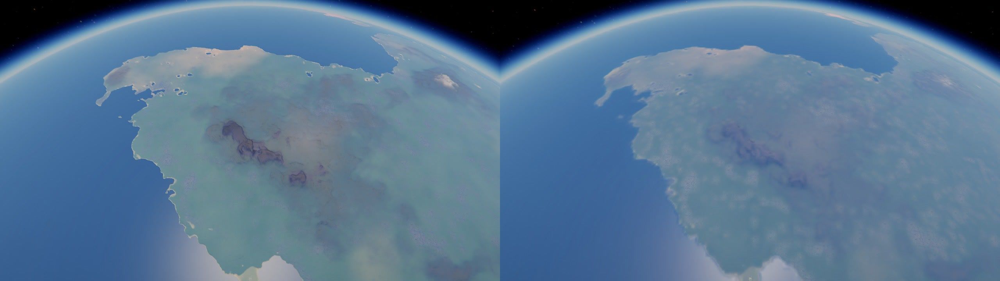
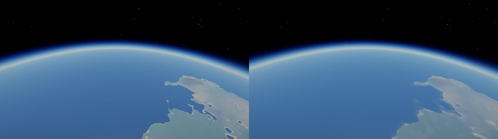

# Far Ground

Kerbin's ground drawn all the way to the horizon.

The game draws its ground finely near the camera and as a few big, coarse pieces far off: from the clouds' height the
mountains on the horizon are smooth humps. Far Ground draws the far ground again, on the graphics card, at a point every few
pixels, from the game's own heights, decals and land: the ranges, ridges and valleys far away as they really are in the
game. Nothing is invented and nothing is stored.

For Kerbal Space Program 1.12.x. **Needs [Keystone](https://github.com/IshiakiZ/ksp-keystone) 0.9 or later**, a separate download
([on SpaceDock](https://spacedock.info/mod/4665/Keystone)): this mod does not load without it.

## Install

Copy the `FarGround` folder from the download into your KSP's `GameData`, beside `Keystone`.

## Use

It is on as installed. In the Keystone window (the keystone button on the game's toolbar, or Alt-K; Option-K on a
Mac), under **Far Ground**: the switch **Far ground**, **Points apart** (2 to 6 pixels: 3 as installed; 2 is the finest and
costs about twice as much), and **The game's own ground within** (6 km as installed: nearer than that, the game's own ground
is drawn, as the game draws it). The window says what it is drawing.

## Good to know

* Kerbin only, for now, and up to 120 km, where the game's own ground has gone into the far planet (above 100 km fading into
  it, as the game's own ground does).
* It checks Kerbin's ground is the game's own when a flight begins there. A planet pack, or another mod that changes
  Kerbin's ground, and it stays off and says why in its window.
* With EVE, its city lights are laid on the far ground too, as EVE lays them on the game's ground.
* It costs about a millisecond of the graphics card a frame (a Mac's, at a point every 3 pixels), and saves the game the
  far pieces of ground it no longer draws.

## Works on

Mac: tried. Windows 11, Direct3D 11: tried 2026-10-20 (from 2 km up, the far land to the horizon and its ranges, as the game's
own ground looks, Scatterer's air over it as over the game's; EVE's city lights on it at night where they are with it off; the
pad's view clear; frames a second as with it off), once its rings were mended for Direct3D's depth. Windows 11, OpenGL on
NVIDIA: tried 2026-10-20 (drawn, since a variable named `packed` in its draw shader was renamed). Linux: never run.

**More:** [how it works](docs/How-it-works.md) and the rest of the [wiki](docs/README.md).

## Licence

[CC BY 4.0](LICENSE): use it, change it and pass it on as you like, as long as you credit Ishiaki and link back here.
